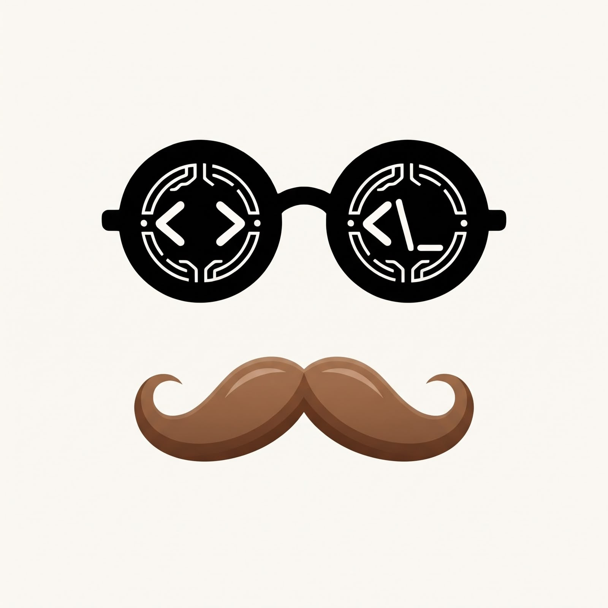

# Mr. Support

**Mr. Support — AI support, human in control.**

Open-source, Rust-based remote support tool where a swarm of specialized AI agents can see the screen and act in parallel to fix problems, while the user supervises, approves each action, and can revoke access instantly.

## Platforms

**Windows, macOS, Linux, Android, iOS** — like AnyDesk and TeamViewer.

## Logo



Logo by Emma: glasses with mustache, Camilo/Pringles style. Floating glasses + mustache arranged as on an invisible face, no face, no spy vibe. Official logo approved 2026-11-21.

## Vision

A remote desktop built on RustDesk (AGPL-3.0) with an AI agent layer:
- AI sees the screen via a raw-frame tap (1-5 fps, reduced resolution)
- Multi-agent swarm from day one: coordinator + specialized agents (diagnostics, network, apps, security, files) working in parallel
- Single input queue serialized by the coordinator to avoid conflicts
- Human supervision: explicit per-session consent, visible "AI operating" indicator, instant revocation, full audit log

## Repository structure

```
mr-support/
├── Cargo.toml
├── README.md
├── PLAN.md
├── .gitignore
├── src/
│   ├── main.rs
│   ├── lib.rs
│   ├── agent/       # AI agent layer (vision + grounding)
│   ├── swarm/       # Coordinator + specialized agents
│   ├── consent/     # Consent model & approval flow
│   ├── audit/       # Audit log
│   ├── transport/   # RustDesk integration (scrap, enigo, hbb_common)
│   └── platform/    # OS abstractions
│       ├── macos/
│       ├── windows/
│       ├── linux/
│       ├── android/
│       └── ios/
├── docs/            # Architecture docs
├── assets/          # Logo (Emma) and brand assets
├── examples/
└── tests/
```

## Status

Planning + initial structure. See [PLAN.md](PLAN.md) for architecture, license analysis, milestones (M0-M7), and security/consent model.

## License

Planned: AGPL-3.0 for the RustDesk-derived core. See PLAN.md section 5 for details. Final license files to be added before public release.

## Contributing

Coming soon. This project is built to give back to the open-source community.

---

Built with Rust. Inspired by RustDesk.
